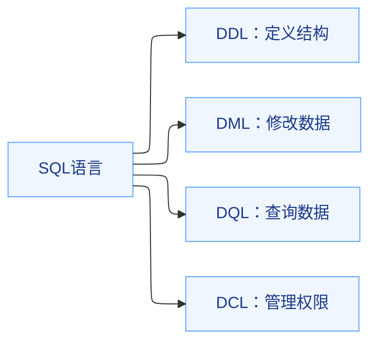
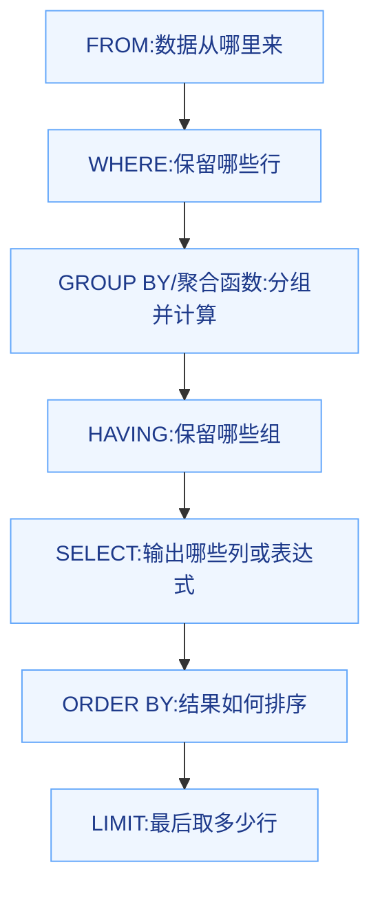
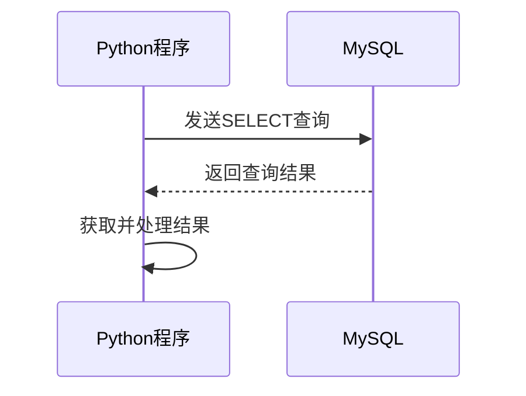

# MySQL 基础图解与 PyMySQL 速查

**目录导航**

- **[一、SQL 语言的分类](#一sql语言的分类)**
- **[二、SQL 语言的注释](#二sql语言的注释)**
- **[三、SQL 基础与 DDL](#三sql基础和sql-ddl数据定义语言)**
  - [数据库操作](#一数据库操作)
  - [DDL 表管理](#二ddl-表管理)
- **[四、DML：数据操作](#四sql-dml数据操作语言)**
  - [数据插入 INSERT](#一数据插入insert)
  - [数据删除 DELETE](#二数据删除delete)
  - [数据更新 UPDATE](#三数据更新update)
- **[五、DQL：数据查询](#五sql-dql数据查询语言)**
  - [基础查询](#一基础查询)
  - [分组聚合](#二分组聚合)
  - [排序分页](#三排序分页)
- **[六、DCL：数据控制](#六sql-dcl数据控制语言)**
  - [账号与权限](#一账号与权限)
  - [账号管理与授权](#二账号管理与授权)
  - [权限检查](#三权限检查)
- **[七、Python 操作 MySQL](#七python-操作-mysqlpymysql)**
  - [安装](#一安装)
  - [连接与查询](#二连接与查询)
  - [常用方法](#三常用方法)
  - [提交设置](#四提交设置)
- **[Tips](#tips)**
- **[参考资料](#参考资料)**

## 一、SQL语言的分类

| 分类 | 英文全称 | 中文名称 | 作用 |
| :---: | :--- | :---: | :--- |
| DDL | Data Definition Language | 数据定义语言 | 定义和修改数据库、表等结构 |
| DML | Data Manipulation Language | 数据操作语言 | 增加、修改、删除数据 |
| DQL | Data Query Language | 数据查询语言 | 查询数据 |
| DCL | Data Control Language | 数据控制语言 | 授予和撤销权限 |



## 二、SQL语言的注释

SQL语言的注释方法有以下三种，分为单行注释和多行注释：

**单行注释**：

```sql
-- 注释
```

```sql
# 注释
```

**多行注释**：

```sql
/*
注释
*/
```

## 三、SQL基础和SQL-DDL(数据定义语言)

### 一、数据库操作

**查看数据库：** `SHOW DATABASES;`

**使用数据库：** `USE 数据库名称;`

**创建数据库：** `CREATE DATABASE 数据库名称 [CHARSET utf8mb4];`

**删除数据库：** `DROP DATABASE 数据库名称;`

**查看当前使用的数据库：** `SELECT DATABASE();`

### 二、DDL-表管理

**查看表：** `SHOW TABLES;`

> [!TIP]
> 需要先选择数据库。

**删除表：** `DROP TABLE 表名称;`或`DROP TABLE IF EXISTS 表名称;`

**创建表：**

```sql
CREATE TABLE 表名称 (
    列名称1 列类型,
    列名称2 列类型
);
```

**常见列类型：**

- `INT：`整数
- `FLOAT：`浮点数
- `VARCHAR(n)：`文本，长度为数字，最多n个字符
- `DATE：`日期类型
- `TIMESTAMP：`时间戳类型

## 四、SQL-DML（数据操作语言）

### 一、数据插入INSERT

**语法：**

```sql
INSERT INTO 表 [(列1, 列2, ……, 列N)]
VALUES (值1, 值2, ……, 值N)
    [, (值1, 值2, ……, 值N), ……];
```

### 二、数据删除DELETE

**语法：** `DELETE FROM 表 [WHERE 条件判断];`

条件判断：列 操作符 值

条件判断内部不强制空格

操作符：> < >= <= !=等

### 三、数据更新UPDATE

**语法：** `UPDATE 表 SET 列=值 [WHERE 条件判断];`

## 五、SQL-DQL（数据查询语言）

### 一、基础查询

**基础查询语法：** `SELECT 字段列表|* FROM 表;`

**过滤查询语法：** `SELECT 字段列表|* FROM 表 WHERE 条件判断;`

### 二、分组聚合

**语法：**

```sql
SELECT 分组列, 聚合函数(列)
FROM 表
[WHERE 条件判断]
GROUP BY 分组列;
```

**聚合函数：**

**适用条件：** 不带 `GROUP BY` 的聚合查询。

| **函数** | **作用** | **NULL 的处理** | **无匹配行时** |
| :---: | :--- | :---: | :---: |
| `SUM(列)` | 求和 | 忽略 | `NULL` |
| `AVG(列)` | 求平均值 | 忽略 | `NULL` |
| `MIN(列)` | 求最小值 | 忽略 | `NULL` |
| `MAX(列)` | 求最大值 | 忽略 | `NULL` |
| `COUNT(*)` | 统计行数 | **计入所有行** | `0` |
| `COUNT(列)` | 统计非空值数量 | 忽略 | `0` |

> [!NOTE]
> 分组列决定按什么分组，聚合表达式决定每组计算什么；`SELECT` 可以同时写两者，聚合函数处理的列不必出现在 `GROUP BY` 中。

### 三、排序分页

**结果排序：** 使用`ORDER BY`关键字，指定某个列进行排序

**语法：**

```sql
SELECT 字段列表|*
FROM 表
[WHERE 条件判断]
[GROUP BY 分组列]
[HAVING 分组条件]
ORDER BY 排序列 [ASC | DESC];
```

**分页排序：** 使用`LIMIT`关键字，对查询结果进行数量限制或分页显示

**语法：**

```sql
SELECT 字段列表|*
FROM 表
[WHERE 条件判断]
[GROUP BY 分组列]
[HAVING 分组条件]
[ORDER BY 排序列 [ASC | DESC]]
LIMIT n[, m];
```

只写 `n` 时，取前 `n` 行；写 `n, m` 时，跳过前 `n` 行，再取 `m` 行。

**逻辑处理顺序：** FROM → WHERE → GROUP BY和聚合函数 → HAVING → SELECT → ORDER BY → LIMIT



## 六、SQL-DCL（数据控制语言）

### 一、账号与权限

**账号格式：** `'用户名'@'主机'`，MySQL 账号由用户名和主机部分共同标识。

**常用权限：**

- `SELECT：`查询数据
- `INSERT：`插入数据
- `UPDATE：`修改数据
- `DELETE：`删除数据
- `CREATE：`创建数据库或表

**权限范围：** `数据库名.表名` 表示一张表；`数据库名.*` 表示某个数据库中的所有表；`*.*` 表示全局范围。

### 二、账号管理与授权

**创建账号：** `CREATE USER '用户名'@'主机' IDENTIFIED BY '密码';`

**查看当前账号权限：** `SHOW GRANTS;`

**查看指定账号权限：** `SHOW GRANTS FOR '用户名'@'主机';`

**授予权限：** `GRANT 权限 ON 数据库名.表名 TO '用户名'@'主机';`

**撤销权限：** `REVOKE 权限 ON 数据库名.表名 FROM '用户名'@'主机';`

MySQL 8.0 中先创建账号，再授予权限。撤销权限会改变授权，账号仍然保留；查看其他账号的权限需要相应权限。

**生效规则：** 使用 `GRANT`、`REVOKE` 后，MySQL 自动更新权限信息；表级权限变更在下一次请求时生效。

### 三、权限检查

**查看认证账号：** `SELECT CURRENT_USER();`，返回当前连接用于权限检查的账号。

**授权效果：** 只有某表的 `SELECT` 权限时，可以查询该表，插入操作会返回权限错误；撤销 `SELECT` 权限后，查询操作也会返回权限错误。

## 七、Python 操作 MySQL（PyMySQL）

### 一、安装

**作用：** 使用 Python 的第三方库 `pymysql` 连接 MySQL、执行 SQL。

**安装命令：** `python -m pip install pymysql`，在终端执行，安装到该 `python` 命令对应的环境中。

### 二、连接与查询

**参数：** `host` 为服务器主机，`localhost` 表示本机；`port` 为端口，默认 `3306`；`user`、`password` 为账号和密码。

**连接与查询模板：** 查询已存在的数据库和表，连接账号具有相应查询权限。

```python
from pymysql import Connection

conn = Connection(
    host="localhost",
    port=3306,
    user="dcl_student",
    password="替换为该账号的实际密码"
)

try:
    cursor = conn.cursor()
    conn.select_db("dcl_practice")
    cursor.execute("SELECT * FROM student")
    results: tuple = cursor.fetchall()
    for r in results:
        print(r)
finally:
    conn.close()
```

**执行顺序：** 建立连接 → 创建游标 → 选择数据库 → 执行 SQL → 获取并处理结果 → 关闭连接。

**类型注解：** `results: tuple` 为变量 `results` 标注预期类型 `tuple`。运行时类型由赋给变量的值决定。

**关闭连接：** 将 `conn.close()` 放在 `finally` 中，在正常结束或发生异常时执行关闭连接。




### 三、常用方法

**游标类型：** 查询结果按默认 `Cursor` 的普通查询说明。

| **所属对象** | **调用方式** | **作用** | **返回内容** |
| :---: | :--- | :--- | :---: |
| 连接类 | `Connection(...)` | 创建连接 | 连接对象 |
| 连接对象 | `conn.cursor()` | 创建游标 | 游标对象 |
| 连接对象 | `conn.select_db("数据库名")` | 选择数据库 | `None` |
| 连接对象 | `conn.get_server_info()` | 获取服务器版本 | 字符串 |
| 连接对象 | `conn.commit()` | 提交事务 | `None` |
| 连接对象 | `conn.close()` | 关闭连接 | `None` |
| 游标对象 | `cursor.execute("SQL语句")` | 执行 SQL | 整数：行数 |
| 游标对象 | `cursor.fetchall()` | 获取尚未读取的全部结果行 | 结果行元组 |

**选择数据库：** `conn.select_db("数据库名")` 相当于 `USE 数据库名;`。

**SQL 分类：** SQL 的用途决定它属于 DDL、DML、DQL 还是 DCL。

### 四、提交设置

**适用条件：** InnoDB，未显式开启事务；建表指普通非临时表。

| **SQL 操作** | **`autocommit=False`** | **`autocommit=True`** |
| :--- | :--- | :--- |
| 普通 `SELECT` | 读取结果无需提交 | 读取结果无需提交 |
| `INSERT`、`UPDATE`、`DELETE` | 调用 `conn.commit()` 提交更改 | 语句成功后自动提交 |
| 普通 `CREATE TABLE` | 隐式提交 | 隐式提交 |

**手动提交：** 在相关更改成功后、关闭连接前提交当前事务，可以合并提交多条更改。

**默认设置：** PyMySQL 默认 `autocommit=False`。

**查看自动提交开关：** `SELECT @@autocommit;`，显示当前连接的自动提交设置，`1` 为开启，`0` 为关闭。

**DBeaver：** 提交方式取决于当前连接模式。DBeaver 与 PyMySQL 使用各自的连接，设置可以不同。

## Tips

**1. 大小写：** SQL 关键字通常不区分大小写；数据库名和表名的大小写规则受系统及配置影响。

**2. 标点：** 在 SQL 编辑器中用英文分号结束完整语句，代码中的逗号、括号和引号使用英文字符。

**3. 字符串：** SQL 字符串推荐使用单引号；MySQL 中双引号的含义受 SQL 模式影响。

**4. 语法模板：** 方括号表示可选部分，竖线表示备选项之间的分隔；编写 SQL 时选取需要的内容。

**5. 数据库选择：** `SHOW TABLES` 等操作需要先选中数据库，也可以在支持的位置写完整的 `数据库名.表名`。

**6. 运行环境：** 安装包与运行代码应使用同一个 Python 环境。在 PowerShell 中安装包，在 Python 文件中编写代码，在 DBeaver 的 SQL 编辑器中执行 SQL。

**7. 名称与参数：** Python 中导入写 `pymysql`；`Connection`、`True` 的首字母大写；连接参数之间用英文逗号分隔。

**8. 登录失败：** `1045`、`Access denied for user` 表示登录验证被拒绝，先核对账号、密码及服务器地址和端口。`using password: YES` 只表示提供了密码。

**9. 权限不足：** `INSERT command denied`、`SELECT command denied` 表示当前账号缺少相应的插入或查询权限。

## 参考资料

- [黑马程序员 Python 教程：SQL 与 MySQL 章节](https://www.bilibili.com/video/BV1qW4y1a7fU/?p=127)
- [MySQL 8.0 官方文档](https://dev.mysql.com/doc/refman/8.0/en/)
- [PyMySQL 官方文档](https://pymysql.readthedocs.io/en/latest/)
- [Mermaid 官方文档](https://mermaid.js.org/)

